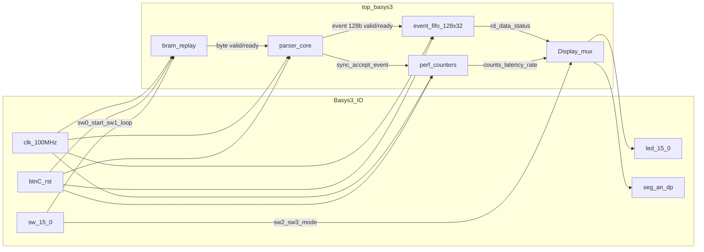
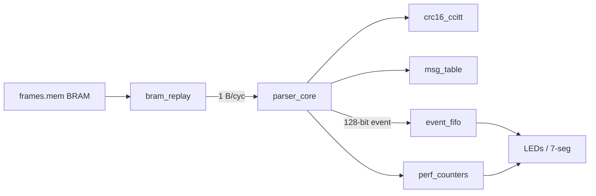
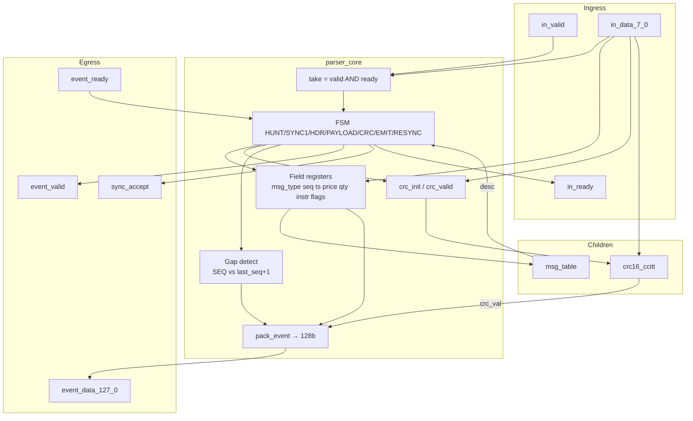
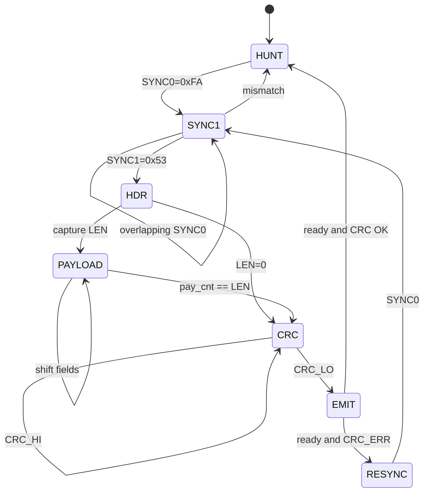
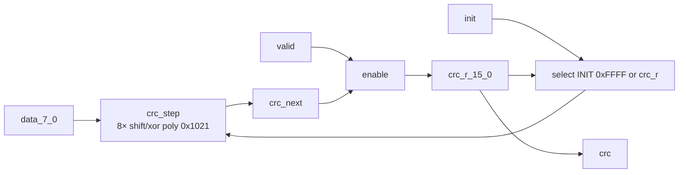
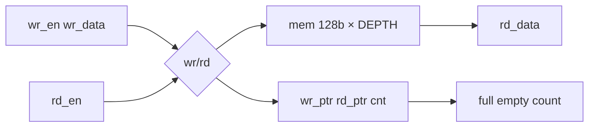
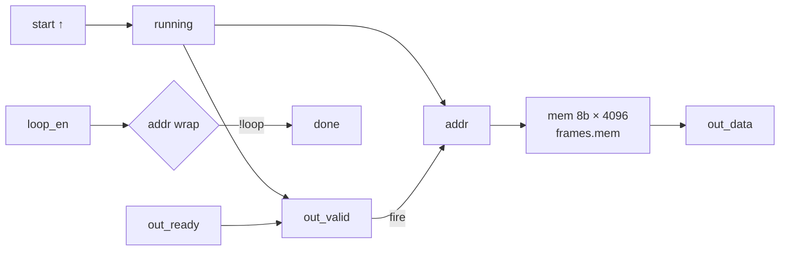
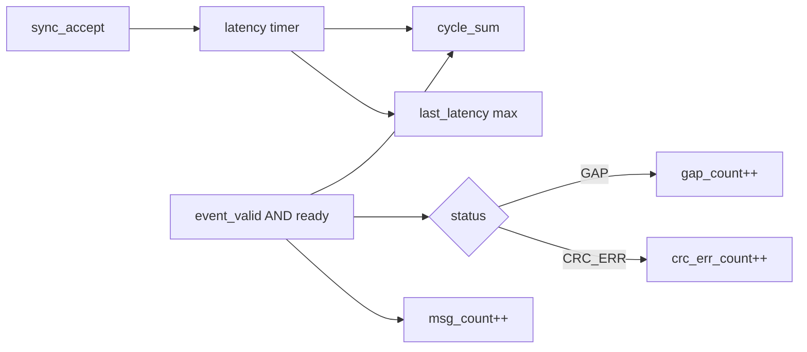

# Circuit Diagrams - FPGA Streaming Parser Accelerator

Basys 3 / Artix-7 · `top_basys3` · 100 MHz · 1 byte/cycle

## Hierarchy

```
top_basys3
├── bram_replay          # corpus → byte stream
├── parser_core          # streaming FSM
│   ├── crc16_ccitt      # live CRC16-CCITT
│   └── msg_table        # MSG_TYPE → layout ROM
├── event_fifo           # 128-bit × 32 events
└── perf_counters        # msg/crc/gap + latency
    (+ display mux → LED / 7-seg)
```

---

## 1. Top-level (`top_basys3`)



### Top-level data path (simplified)



---

## 2. Module-wise - `parser_core`



### FSM state diagram



---

## 3. Component-wise

### `crc16_ccitt`



### `msg_table`

```mermaid
flowchart LR
  MT[msg_type_7_0] --> CASE{case}
  CASE -->|0x01 Trade| ALL[valid LEN=18 FE_ALL]
  CASE -->|0x02 Quote| ALL
  CASE -->|0x03 HB| HB[valid FE_SEQ|TS|FLAGS]
  CASE -->|default| UNK[valid=0 FE_ALL]
  ALL --> DESC[desc]
  HB --> DESC
  UNK --> DESC
```

### `event_fifo` (DEPTH=32)



### `bram_replay`



### `perf_counters`



---

## 4. 128-bit event word


| Bits | Field |
|------|--------|
| 127:120 | status |
| 119:112 | msg_type |
| 111:96 | seq |
| 95:64 | timestamp |
| 63:32 | price |
| 31:16 | qty[31:16] |
| 15:0 | instr_id |

---

## 5. Port summary

| Module | Key inputs | Key outputs |
|--------|------------|-------------|
| `bram_replay` | start, loop_en, out_ready | out_valid, out_data[7:0], done |
| `parser_core` | in_valid, in_data, event_ready | in_ready, event_valid, event_data, sync_accept |
| `crc16_ccitt` | init, valid, data | crc[15:0] |
| `msg_table` | msg_type | desc |
| `event_fifo` | wr_en, wr_data, rd_en | full, empty, rd_data, count |
| `perf_counters` | sync_accept, event_*, status | msg_count, crc_err, gap, latency |

Source RTL: [`rtl/`](../rtl/). Protocol: [`protocol.md`](protocol.md).
