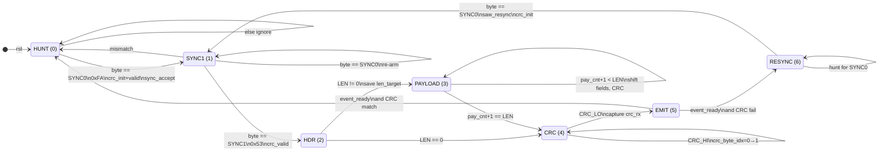
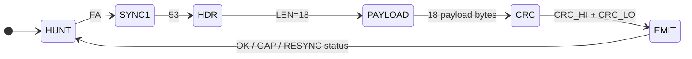

# parser_core Finite State Machine

Source of truth: [`rtl/parser_core.sv`](../rtl/parser_core.sv) · states in [`rtl/parser_pkg.sv`](../rtl/parser_pkg.sv)

Clocked on `clk`; transitions occur when a byte is accepted (`take = in_valid && in_ready`), except **EMIT**, which waits on `event_ready` (no byte intake).

## State diagram

## Happy-path (23B frame, LEN=18)

## State reference

| State | Code | Consumes bytes? | What it does |
|-------|-----:|:---------------:|--------------|
| HUNT | 0 | yes | Search for `0xFA` |
| SYNC1 | 1 | yes | Expect `0x53`; allow overlapping `0xFA` |
| HDR | 2 | yes | Capture LEN; CRC fold |
| PAYLOAD | 3 | yes | Shift fields by `pay_cnt`; gap-detect on SEQ; CRC fold |
| CRC | 4 | yes | Capture 2 CRC bytes (**no** CRC engine update) |
| EMIT | 5 | **no** (`in_ready=0`) | Drive `event_valid` / `event_data` until ready |
| RESYNC | 6 | yes | After CRC_ERR; search SYNC0 with `saw_resync` |

## Transition table

| From | Condition | To |
|------|-----------|-----|
| HUNT | `in_data == 0xFA` | SYNC1 |
| SYNC1 | `in_data == 0x53` | HDR |
| SYNC1 | `in_data == 0xFA` | SYNC1 |
| SYNC1 | else | HUNT |
| HDR | `LEN == 0` | CRC |
| HDR | `LEN != 0` | PAYLOAD |
| PAYLOAD | `pay_cnt+1 == len_target` | CRC |
| PAYLOAD | else | PAYLOAD |
| CRC | first CRC byte | CRC |
| CRC | second CRC byte | EMIT |
| EMIT | ready ∧ CRC OK | HUNT |
| EMIT | ready ∧ CRC bad | RESYNC |
| RESYNC | `in_data == 0xFA` | SYNC1 |

## EMIT status priority

Computed combinationally while in EMIT:

1. `CRC_ERR` if `crc_val != crc_rx`
2. else `GAP` if `gap_flag`
3. else `RESYNC` if `saw_resync`
4. else `OK`
